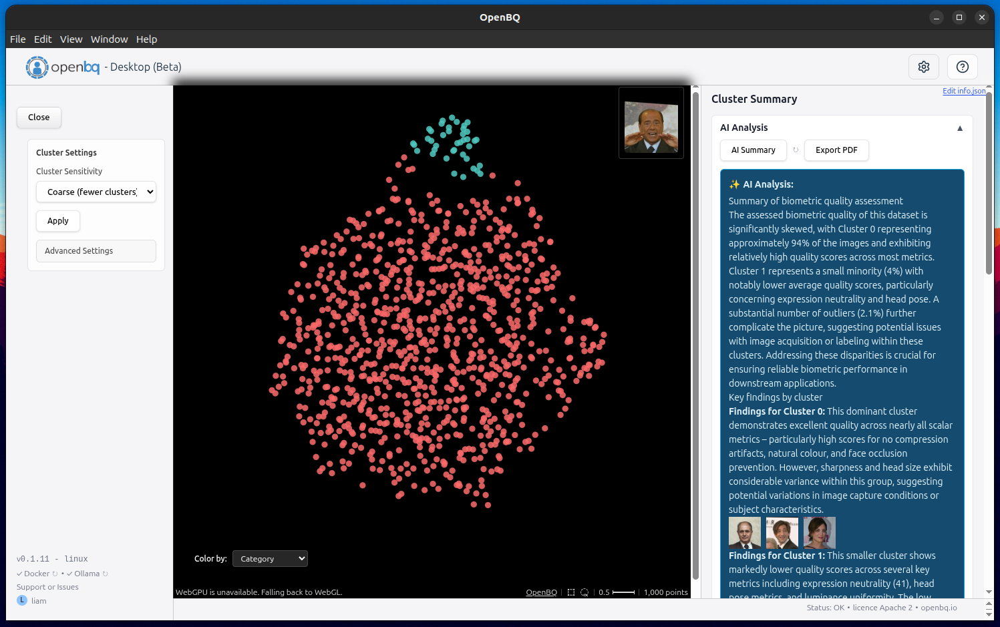

<details open markdown="block">
  <summary>
    Table of contents
  </summary>
  {: .text-delta }
- TOC
{:toc}
</details>

---

## BQInsights Workspace



> This project is in beta for early access and is not recommended for production environments.

## Prerequisites

You can run the application on Windows, macOS, and Linux. Both ARM and x86 platforms are supported.

- [ ] [Git](https://git-scm.com/install/) (to sync source code)
- [ ] [Python](https://www.python.org/downloads/) (to provide application runtime, Windows only)
- [ ] [Node.js](https://nodejs.org/en/download) (to provide application runtime)
- [ ] [Bun](https://bun.com/get) (to provide application runtime)
- [ ] [Visual Studio](https://visualstudio.microsoft.com/downloads/) (use Desktop development with C++ workload, Windows only)
- [ ] [Docker](https://docs.docker.com/get-started/get-docker/) (to host data processing backend)
- [ ] [Ollama](https://ollama.com/download) (to provide local AI capability)

### Start AI service

You could use Ollama desktop app or run the AI server via docker container:

```sh
docker run -d --gpus=all -v ollama:/root/.ollama -p 11434:11434 --name ollama ollama/ollama
```

> You don’t have to use Ollama for hosting LLM. You can bring your own AI model—the application supports OpenAI- or Claude-compatible models, hosted locally or remotely.

## Set Up

- Find a location on your computer, open a terminal and run:

```sh
git clone https://github.com/Open-Source-Biometric-Quality-Framework/bqInsights.git
```

This will pull the source code to the current directory.

- Go into the project directory (`/bqInsights`) and run the commands below to build and install the project:

```sh
bun install
```

```sh
bun run build:openbq
```

- Once all dependencies properly configured, run the following command to start up the application:

```sh
bun run dev:openbq
```

## Update

- Pull latest changes from the source code repository:

```sh
git pull
```

## Uninstall

- Simply remove the project directory.

---

## AI Models

In terms of AI model selection, have a look at spec of your computer, select a AI model that fits memory of your computer.

> Leave at least 5–10% memory headroom for your operating system to ensure stability.

### Consumer Grade Device

| GPU | VRAM |
| --- | --- |
| RTX 5060 | 8GB |
| RTX 5080 | 16GB |
| RTX 5090 | 32GB |

> For Mac, Nvidia Spark, AMD Ryzen AI Halo, or other machine with integrated GPU, system memory is shared across CPU and GPU, so the vram numbers above will be roughly equivalent to your total memory.

### Professional Grade Machine

| GPU | VRAM |
| --- | --- |
| RTX PRO 5000 | 48 or 72 GB |
| RTX PRO 6000 | 96GB |
| DGX Spark | 128GB |
| H200 | 141GB |
| B300 | 288GB |


### Models

| Model | Size |
| --- | --- |
| gemma4:12b | 7.6GB |
| qwen3.8:27b | 18GB |
| gemma4:31b | 20GB |
| Qwen3.8-Flash-Next-GGUF, 4-bit | 111GB |
| GLM-5.3-Flash-GGUF, 4-bit | 200GB |
| DeepSeek-V4.1-Flash-1017-GGUF, 4-bit | 501GB |
| Muse-Spark-Open-816B-A42B-GGUF, 4-bit | 506GB | 

### Performance Esimation

| Device | Speed (tokens/s) |
| --- | --- |
| RTX 5060 | 62 |
| RTX 5090 | 152 |
| RTX PRO 5000 | 120 |
| RTX PRO 6000 | 152 |
| DGX Spark | 40 |
| M4 Max | 61 |
| M5 Max | 69 |
| H200 | 407 |
| B300 | 679 |
| AWS Trainium3 | 416 |
| Google Ironwood | 625 |

> Note: Performance numbers based on Gemma 4 E4B, Q4_K_M, decode speed rough estimation, prefill not considered.
